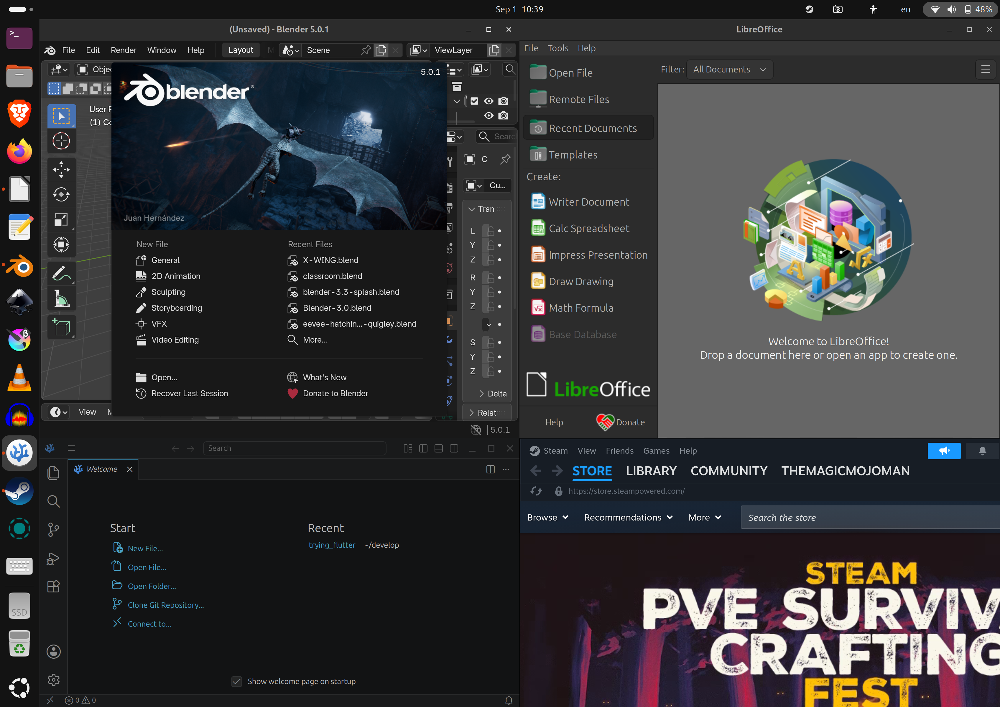

<h1 align="center">Ubuntu Linux on the OnePlus Pad 3 tablet (codename: erhai)</h1>

A full **Ubuntu GNOME desktop** on your OnePlus Pad 3 — dual-booted with Android. With GPU-accelerated graphics on the 3392x2400 px display or an external monitor over USB-C or HDMI, pogo keyboard, Wi-Fi & Bluetooth, fast charging and up-to-date Linux 7.3 kernel.

Do professional work with LibreOffice, Gimp, Blender, VSCode, ... and thousands of other beloved Linux apps. Want to play PC games? Use hangover or steam that use FexEmu/Proton/Wine under the hood.

A real Linux tablet PC that utilizes the full power of the Snapdragon 8 Elite!
 
* Device: **OnePlus Pad 3** (codename `erhai`, Snapdragon 8 Elite / SM8750).
* Device: **OnePlus Pad 2+** (codename `erhai`, Snapdragon 8 Elite / SM8750) - !!!**NOT TESTED**, yet!!!

> ⚠️ Installing **erases all Android data and apps** — Android only comes back as a factory-reset device. **Back up everything** before you proceed!

## Documentation

* [**Installation**](docs/installation.md) — prerequisites, partitioning, flashing the installer, post-install setup
* [**Status**](docs/status.md) — what works, what does not (yet), known issues
* [**Credits**](docs/credits.md) — the people this project stands on
* [**Delete Linux, Recover Android**](docs/recoverandroid.md) — delete Linux and give the whole disk back to Android

## Community

Linux on the OnePlus Pad 2+/3 — Telegram: <https://t.me/erhai_linux>

Made with ❤️  in Hamburg, Germany

